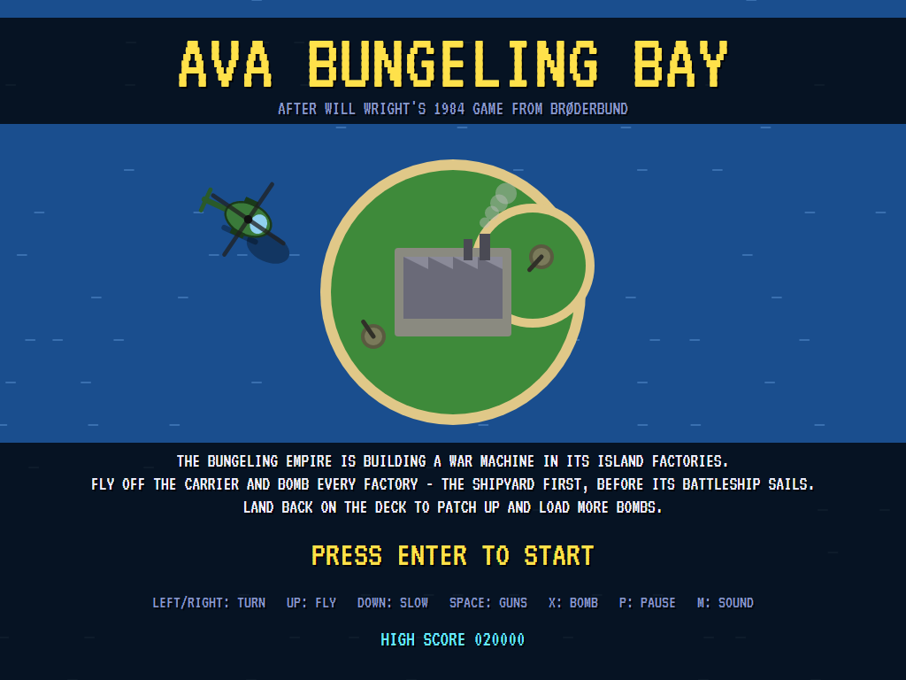
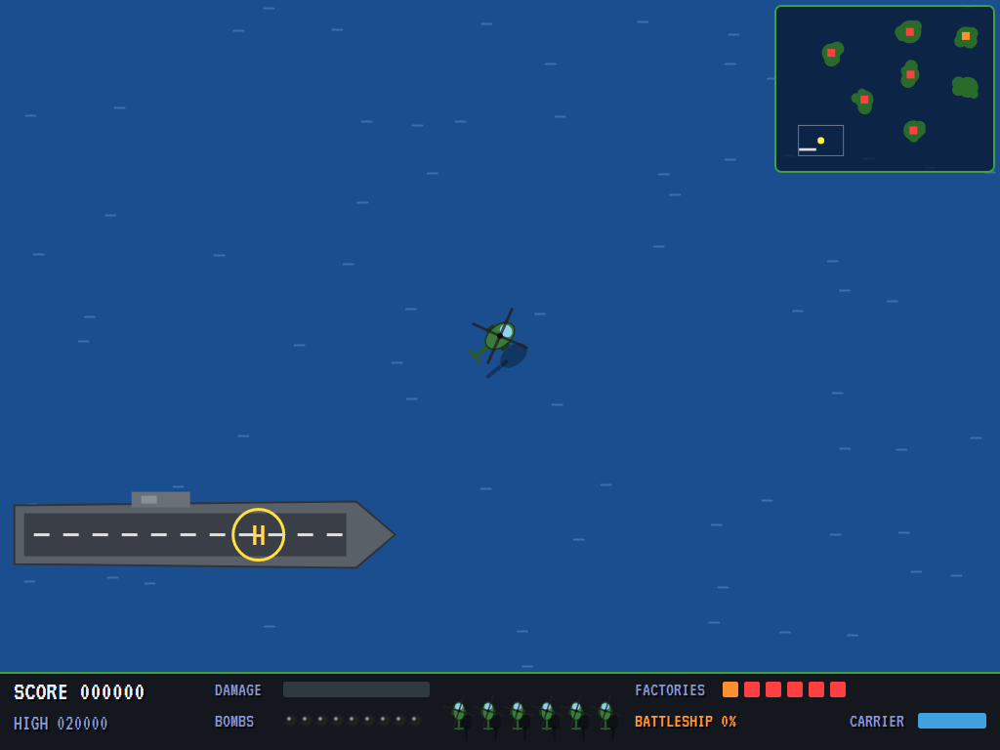
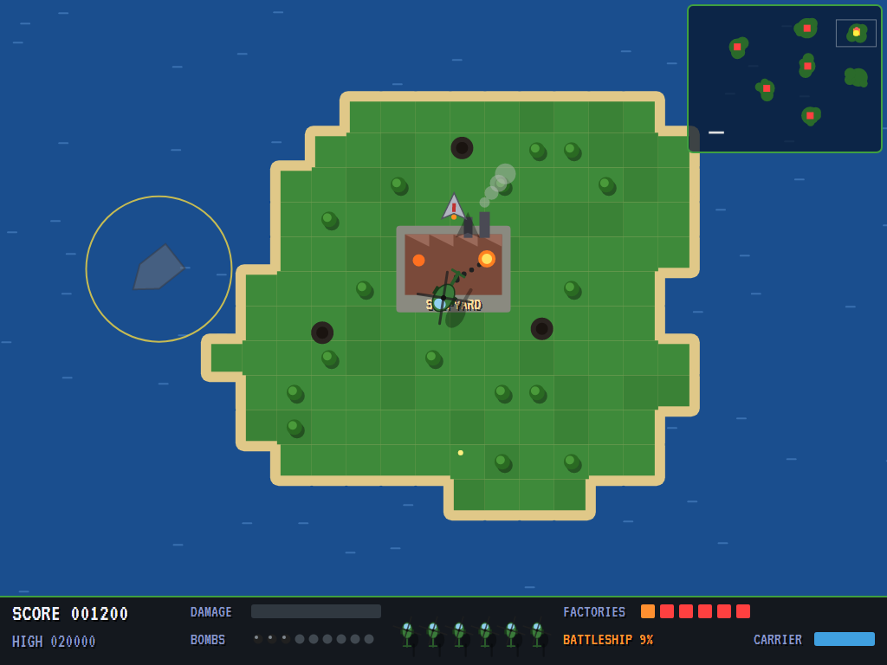
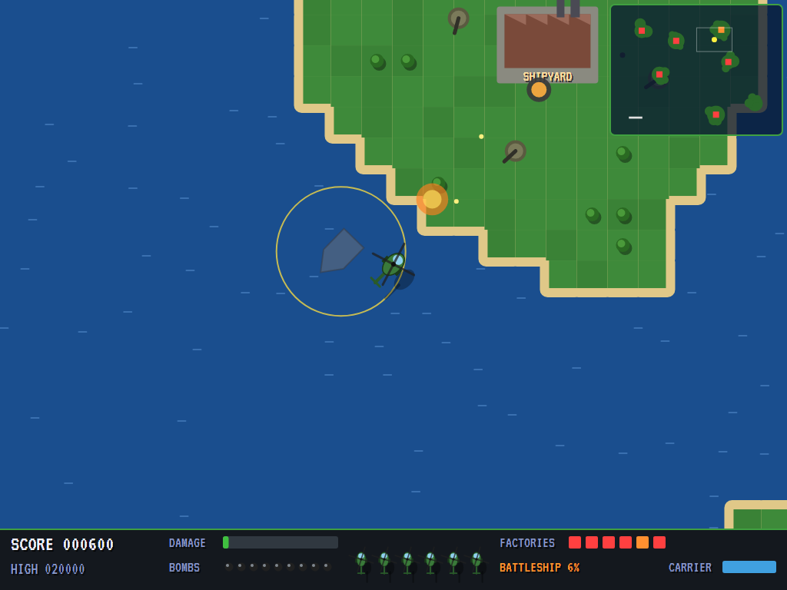
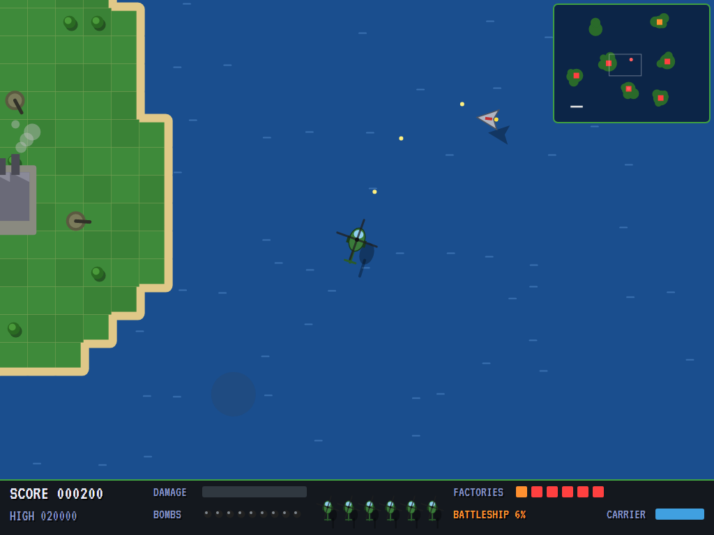
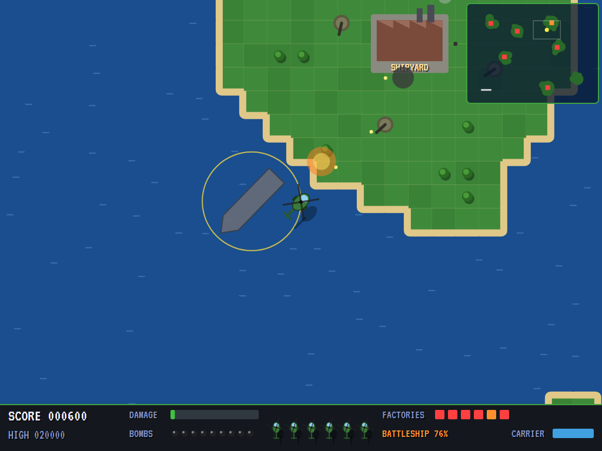
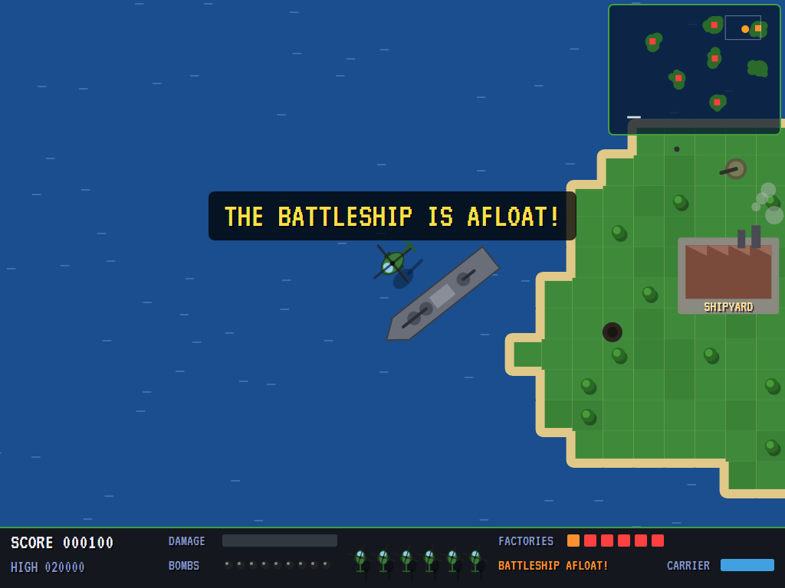
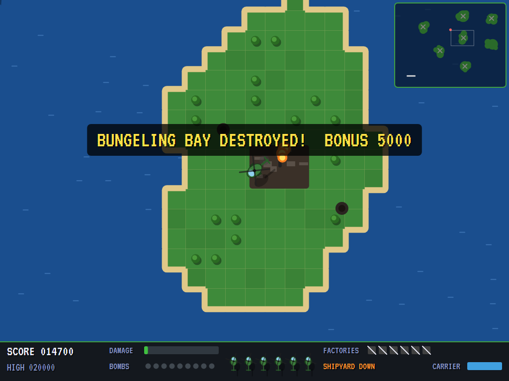
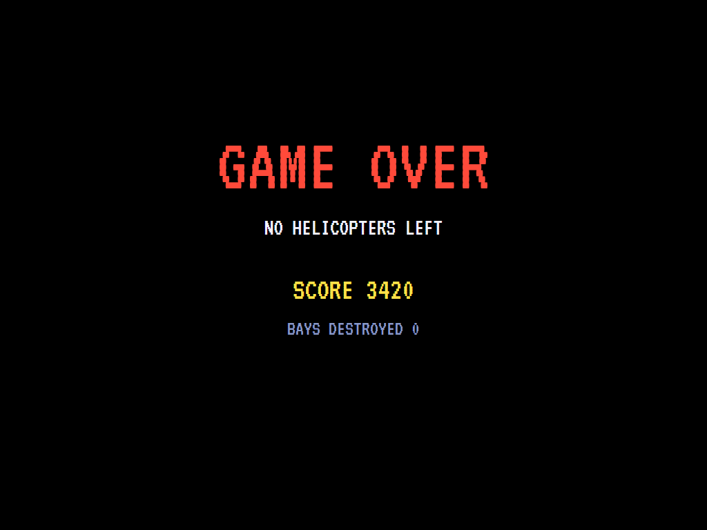
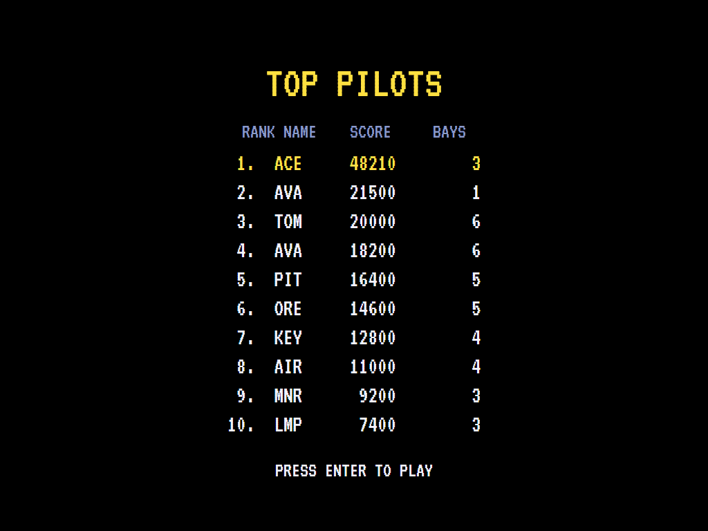

# AVA Bungeling Bay

[](https://github.com/Harlock123/AVABungelingBay/actions/workflows/build.yml)

A top-down helicopter raid in the style of Will Wright's 1984 Brøderbund game **Raid on Bungeling Bay**,
built with .NET 10 and Avalonia UI. The Bungeling Empire is building a war machine in its island factories.
Fly off your aircraft carrier, bomb every factory in the bay, and land back on the deck to patch up and
load more bombs. Meanwhile the shipyard is building a battleship. If it's finished, it will sail out and
sink your carrier.

## Features

- **Five bays**, each with seven islands, six factories (one of them **the shipyard**), and anti-aircraft
  guns round them. Each bay is better defended than the last: more guns, faster flak, faster jets, and a
  battleship built sooner.
- **The helicopter** turns left and right, flies forward with up, and slows (or backs off) with down. Its
  guns fire a stream straight ahead. Its bombs fall a moment after they're dropped, carrying on the way it
  was going, so you aim by leading. Damage slows it, and enough damage brings it down.
- **The carrier:** come down slowly over the deck and the helicopter lands. On deck it's patched up and
  loaded with nine bombs, a few at a time.
- **The factories** take three bombs each (guns don't touch them). While they work, they send up **jets**
  after a helicopter that comes near. Jets chase, fire in bursts and overshoot, then come round again. Two
  rounds bring one down.
- **The guns** on the islands fire flak at where you'll be when the shell gets there. Keep moving, or shoot
  them out.
- **The battleship** is built at the shipyard, faster the more factories are still working. Bomb the
  shipyard and it's never finished. If it's launched, it steers round the islands to the carrier and
  shells it. Forty points of damage sink it: bombs do five each, guns only a little. Lose the carrier and
  the game is over, however many helicopters are left.
- **Clearing a bay** scores a bonus for the carrier's condition and an extra helicopter.
- **The radar** shows the whole bay: islands, factories (the shipyard in orange), the carrier, jets and
  the battleship.
- **The attract mode** shows the computer pilot at work. It goes for the shipyard first, shoots out the
  guns round its target, turns to fight jets on its tail, and swerves from flak about to burst where it's
  heading. It drops its bombs where they'll fall on the target, and flies home to refit when it's
  battered or out of bombs.

## Screenshots

| The title | Off the carrier | Bombing |
|:---------:|:---------------:|:-------:|
|  |  |  |
| The war machine. | Off the deck. | Bombs on the shipyard. |

| Flak | Jets | The shipyard |
|:----:|:----:|:------------:|
|  |  |  |
| The guns' bursts. | A jet coming round. | The battleship on the slip. |

| The battleship | Bay destroyed | Game over |
|:--------------:|:-------------:|:---------:|
|  |  |  |
| Afloat, and making for the carrier. | The carrier's bonus. | No helicopters left. |



The screenshots are made by the tests, which play the game in a real (headless) window; see
[Tests](#tests).

## Download and run

Ready-to-run builds for Windows, macOS and Linux, on both Intel/AMD and ARM, are on the
[Releases page](https://github.com/Harlock123/AVABungelingBay/releases/tag/latest). **Latest build** is
rebuilt on every push to `main`. Each download is one self-contained executable: no .NET install is
needed.

| Platform | Archive |
|---|---|
| Windows | `AVABungelingBay-win-x64.zip`, `AVABungelingBay-win-x86.zip`, `AVABungelingBay-win-arm64.zip` |
| macOS | `AVABungelingBay-osx-arm64.tar.gz` (Apple silicon), `AVABungelingBay-osx-x64.tar.gz` (Intel) |
| Linux | `AVABungelingBay-linux-x64.tar.gz`, `AVABungelingBay-linux-arm64.tar.gz`, `AVABungelingBay-linux-arm.tar.gz` |

```bash
tar -xzf AVABungelingBay-linux-x64.tar.gz     # or linux-arm64, linux-arm, osx-arm64, osx-x64
./AVABungelingBay
```

On Windows, unzip and run `AVABungelingBay.exe`. On macOS, if Gatekeeper refuses to open it, run
`xattr -d com.apple.quarantine AVABungelingBay` once. Run with `--no-audio` for silence.

**Sound** comes through OpenAL Soft, built in for every platform. In a virtual machine the game
detects it and uses a larger audio buffer, so the sound doesn't break up.

**Gamepads** use SDL2, which is bundled for Windows, macOS and Intel/AMD Linux. ARM Linux builds need it
installed; without it the keyboard still works:

```bash
sudo apt install libsdl2-dev            # Debian / Ubuntu / Raspberry Pi OS
sudo pacman -S --needed sdl2-compat     # Arch / Omarchy
```

## Controls

| Action | Keyboard | Gamepad |
|---|---|---|
| Start | Enter or 1 | Start |
| Turn | Left/right arrows or A/D | Left stick / D-pad |
| Fly forward (and take off) | Up or W | Up |
| Slow down, back off | Down or S | Down |
| Guns (hold for a stream) | Space, Z or Ctrl | A or right trigger |
| Bomb | X or Shift | B or X |
| Pause | P or Esc | Start or Back |
| Sound on/off | M | |
| Screenshot | Ctrl+S (to your Pictures folder) | |

To land, slow right down over the carrier's deck. On the high-score table, type your initials, or use
up/down and Space, then Enter.

## Tests

```bash
dotnet test AVABungelingBay.slnx
```

The game runs in fixed 60 Hz steps, so it plays the same at any frame rate. Everything that moves lives in
one world that can be copied. The tests check:

- **The bays:** six factories on islands, one of them a shipyard with its slip in open water; guns on land;
  open sea round the carrier; each bay better defended than the last. The computer pilot destroys every
  bay, losing no more than three helicopters. Doing nothing, the battleship sinks the carrier.
- **Flying:** forward the way it points and turning clockwise; slowing, backing off, and drifting to a
  stop; damage slowing it; landing on the carrier to be patched up and loaded, and taking off; too fast
  over the deck not landing.
- **Guns and bombs:** a stream forward bringing down a jet; three bombs bringing a factory down; a bomb
  carrying on the helicopter's way; one bomb a press, and none after nine; flak at a sitting target, and the
  gun shot out; enough damage bringing it down.
- **The enemy:** jets sent up to chase and fire and overshoot rather than ram; the battleship built while
  the factories work, at half the pace with half of them down, then sailing for the carrier round the
  islands; the shipyard bombed and the battleship never finished; the battleship shelling the carrier, and
  bombs sinking it.
- **The game:** the bay destroyed with the carrier's bonus, then the next; the next helicopter on the deck;
  the carrier sunk ending the game, then the high-score table; the demonstration; pause; the keys, through
  to the helicopter; the battleship announced.

`tests/AVABungelingBay.Tests/PilotProbe.cs` reports how the computer pilot gets on in each bay, for tuning
(`BAY_PROBE=1`; `BAY_PROBE=lazy` for a pilot who never leaves the deck).

The screenshot tests draw the real screen in a headless window. To refresh the README's pictures:

```bash
BAY_SHOTS=$PWD/Images dotnet test tests/AVABungelingBay.Tests --filter ScreenshotTests
```

## Building

```bash
dotnet build AVABungelingBay.slnx
dotnet run --project src/AVABungelingBay
```

Needs the .NET 10 SDK. The sounds and tunes are made by `tools/make_sounds.py` (standard-library Python):
`python3 tools/make_sounds.py` rewrites `src/AVABungelingBay/Sounds`.

## Project structure

```
AVABungelingBay/
├── AVABungelingBay.slnx
├── src/AVABungelingBay/
│   ├── Engine/
│   │   ├── GameEngine.cs        # States, helicopters, bays in turn, the carrier, the title and demonstration
│   │   ├── Sim.cs               # A bay step by step: flying, guns, bombs, flak, jets, the shipyard and battleship
│   │   ├── World.cs             # Everything that moves, kept together so it can be copied
│   │   ├── Bay.cs               # Islands, factories, guns, how a bay is built, and the five bays
│   │   ├── Pilot.cs             # The computer pilot (the demonstration, and the tests)
│   │   ├── HighScoreTable.cs, InitialsEntry.cs
│   │   ├── InputHandler.cs, ControllerManager.cs  # Keys and an SDL2 gamepad
│   │   └── SoundManager.cs      # Effects and tunes through OpenAL
│   ├── Audio/                   # The OpenAL engine (from the author's AVABand)
│   ├── Views/                   # The drawing: the sea, islands, factories, carrier, ships, jets, radar
│   └── Sounds/                  # The synthesised effects and tunes
├── tests/AVABungelingBay.Tests/ # Bay, gameplay and screenshot tests
├── tools/make_sounds.py
└── Images/                      # Screenshots
```

## About and licence

AVA Bungeling Bay © 2026 Lonnie Watson, under the [MIT License](LICENSE).

*Raid on Bungeling Bay* © 1984 Brøderbund Software, designed by Will Wright; the name belongs to its
current owner. AVA Bungeling Bay is an independent, unofficial game in its style. Its bays, graphics,
sounds, tunes and code are its own; nothing is taken from the original game's program, graphics or sound.
It is not affiliated with or endorsed by any rights holder.
